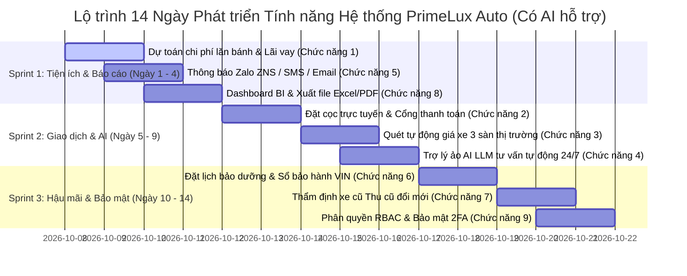

1. 

# BỘ TÀI LIỆU PHÂN TÍCH & ĐỊNH HƯỚNG PHÁT TRIỂN HỆ THỐNG

## HỆ THỐNG QUẢN LÝ CỬA HÀNG Ô TÔ PRIMELUX AUTO

> **Phạm vi & Cơ sở thực hiện:** Tài liệu xác định đúng **9 chức năng trọng tâm cần thiết nhất** dựa trên phạm vi hiện tại của website PrimeLux Auto (Laravel 11/13, Blade Template, MySQL/SQLite).
> **Tối ưu hóa thời gian:** Lộ trình phát triển được tinh chỉnh tính theo **NGÀY** (thay vì tháng) nhờ sự hỗ trợ đắc lực từ các công cụ **Trí tuệ Nhân tạo (AI Coding Assistant)** giúp sinh mã nguồn, viết migration, controller, giao diện Blade/Tailwind và tạo unit test tự động.
> **Quy cách cấu trúc:** Bảng danh mục 2 cột gồm **Chức năng** và **Mô tả chi tiết chức năng**, kèm theo Bảng kế hoạch tiến độ theo ngày chi tiết (14 ngày).
> **Định dạng file tài liệu:** Có sẵn cả file Word chuẩn in ấn (`.doc`, `.docx`) và file Markdown (`.md`).

---

### I. BẢNG DANH MỤC 9 CHỨC NĂNG CẦN THIẾT NHẤT (BẢNG 2 CỘT)

| Chức năng                                                                                                                   | Mô tả chi tiết chức năng                                                                                                                                                                                                                                                                                                                                                                                                                                                                                                                                                                                                                                                                                                                                                                                                                                                                                                                                                                                                                                                                                                                                                                                                                                                                                                                                                                                                                                                       |
| :------------------------------------------------------------------------------------------------------------------------------ | :------------------------------------------------------------------------------------------------------------------------------------------------------------------------------------------------------------------------------------------------------------------------------------------------------------------------------------------------------------------------------------------------------------------------------------------------------------------------------------------------------------------------------------------------------------------------------------------------------------------------------------------------------------------------------------------------------------------------------------------------------------------------------------------------------------------------------------------------------------------------------------------------------------------------------------------------------------------------------------------------------------------------------------------------------------------------------------------------------------------------------------------------------------------------------------------------------------------------------------------------------------------------------------------------------------------------------------------------------------------------------------------------------------------------------------------------------------------------------------ |
| **1. Dự toán chi phí lăn bánh & Bảng tính vay trả góp ngân hàng***(On-Road Cost & Loan Calculator)*                | **• Vị trí tích hợp:** Tích hợp trực tiếp trên trang Chi tiết xe (`/cars/{id}` và `/xe/{id}`).**• Mục tiêu & Nghiệp vụ:** Hỗ trợ người mua xe tính toán tức thì toàn bộ chi phí thực tế theo quy định đăng ký của từng địa phương và lập kế hoạch vay trả góp phù hợp với ngân sách.**• Quy trình hoạt động:**- **Tính chi phí lăn bánh:** Khách hàng chọn tỉnh/thành phố đăng ký biển số (Hà Nội, TP.HCM, các tỉnh khác). Hệ thống tự động áp dụng biểu thuế, phí: Lệ phí trước bạ (10% - 12%), lệ phí cấp biển số (20 triệu tại HN/HCM, 1 triệu tại tỉnh), phí đăng kiểm, phí bảo trì đường bộ 1 năm, bảo hiểm TNDS bắt buộc và bảo hiểm thân vỏ xe.- **Tính toán trả góp vay ngân hàng:** Khách hàng kéo thanh chọn số tiền trả trước (20% - 80%), thời gian vay (1 - 8 năm), lãi suất ưu đãi năm đầu và biên độ các năm tiếp theo. Hệ thống tự động sinh bảng tiến độ trả nợ chi tiết (gốc + lãi) theo dư nợ giảm dần hoặc dư nợ gốc đều.- **Nút kêu gọi hành động:** Khách hàng có thể nhấn *"Gửi hồ sơ thẩm định vay"* để tư vấn viên tài chính liên hệ hỗ trợ.**• Giá trị mang lại:** Minh bạch tài chính, giải tỏa tâm lý đắn đo của người mua, tăng tỷ lệ chuyển đổi từ xem xe sang đăng ký lái thử hoặc mua xe.              |
| **2. Đặt cọc giữ xe trực tuyến & Tích hợp cổng thanh toán***(Online Car Reservation & Payment Gateway)*             | **• Vị trí tích hợp:** Mở rộng từ trang Chi tiết xe và Tra cứu hóa đơn (`/invoices`, `/hoadon`).**• Mục tiêu & Nghiệp vụ:** Cho phép khách hàng thực hiện đặt cọc giữ chỗ chiếc xe ưng ý ngay trên website 24/7 mà không sợ người khác mua mất.**• Quy trình hoạt động:**- Khách hàng chọn xe, tùy chọn màu sắc và showroom nhận xe, sau đó chọn mức đặt cọc tiêu chuẩn (ví dụ: 20.000.000 VNĐ - 50.000.000 VNĐ).- Kết nối trực tiếp cổng thanh toán trực tuyến bảo mật chuẩn PCI-DSS (VNPAY-QR, MoMo, ZaloPay, Thẻ ATM nội địa, Visa/Mastercard).- Sau khi thanh toán thành công qua IPN/Webhook: Hệ thống tự động đổi trạng thái chiếc xe trong cơ sở dữ liệu sang "Đã đặt cọc" trong thời hạn giữ chỗ quy định (48h - 72h) để tránh bán trùng lặp cho khách khác.- Tự động tạo bản thỏa thuận đặt cọc điện tử định dạng PDF có mã QR xác thực và gửi về Email/SMS của khách hàng.**• Giá trị mang lại:** Khép kín chu trình bán hàng từ online đến offline, giảm tỷ lệ khách hàng đổi ý, số hóa nghiệp vụ thu cọc của showroom.                                                                                                                                                                                                                                                                        |
| **3. Tự động hóa quét dữ liệu giá thị trường thực tế***(Automated Market Price Scraper & Analytics)*             | **• Vị trí tích hợp:** Nâng cấp toàn diện trang So sánh giá xe (`/compare`, `/sosanh`, `/cars/{id}/compare`).**• Mục tiêu & Nghiệp vụ:** Thay thế dữ liệu giá so sánh tĩnh/mô phỏng hiện tại bằng luồng dữ liệu giá thực tế được thu thập tự động từ các sàn thương mại điện tử ô tô lớn nhất Việt Nam.**• Quy trình hoạt động:**- Xây dựng bộ thu thập dữ liệu (Web Scraper) bằng Python (Scrapy/Playwright) chạy định kỳ qua Cronjob (mỗi 4 - 6 giờ/lần).- Tự động quét và trích xuất dữ liệu giá xe, năm sản xuất, phiên bản động cơ từ 3 sàn lớn: Oto.com.vn, Bonbanh.com, Chotot Xe.- Chuẩn hóa dữ liệu, loại bỏ tin ảo/tin rác, lưu trữ dữ liệu lịch sử giá vào database.- Hiển thị biểu đồ lịch sử biến động giá xe trong 3 - 6 tháng gần nhất trên giao diện so sánh để người mua thấy rõ mức độ cạnh tranh của giá xe tại PrimeLux Auto.- Cảnh báo cho Admin khi có biến động giảm giá đột biến của đối thủ trên thị trường.**• Giá trị mang lại:** Tạo niềm tin vững chắc cho khách hàng về chính sách giá công khai minh bạch, giúp ban giám đốc có cơ sở điều chỉnh giá bán kịp thời.                                                                                                                                                                                      |
| **4. Trợ lý ảo AI tư vấn tự động 24/7 tích hợp LLM***(LLM-Powered Smart AI Sales Assistant)*                        | **• Vị trí tích hợp:** Nâng cấp module Tư vấn trực tuyến (`/consultant`, `/tuvanvien`) và Widget Chat trên toàn bộ website.**• Mục tiêu & Nghiệp vụ:** Giải đáp tự động tức thì các câu hỏi của khách hàng mọi lúc, mọi nơi; giảm tải công việc trực bàn cho chuyên viên tư vấn.**• Quy trình hoạt động:**- Tích hợp mô hình AI ngôn ngữ lớn (OpenAI GPT-4o / Claude / DeepSeek) được huấn luyện chuyên sâu (RAG - Retrieval-Augmented Generation) trên dữ liệu nội bộ của PrimeLux: Danh mục thông số kỹ thuật xe, giá bán, bảng so sánh ưu nhược điểm, chính sách bảo hành, ưu đãi hội viên VIP.- AI có khả năng hiểu câu hỏi tự nhiên bằng tiếng Việt, tư vấn dòng xe phù hợp với ngân sách gia đình, so sánh sự khác nhau giữa các phiên bản xe.- Khi khách hàng yêu cầu gặp chuyên viên hoặc hỏi câu hỏi đàm phán hợp đồng, AI tự động chuyển cuộc hội thoại sang giao diện Tư vấn viên (Advisor Desk) qua luồng SSE (Server-Sent Events) hiện có, kèm tóm tắt nhu cầu khách hàng.- Tự động trích xuất thông tin khách hàng (tên, số điện thoại, mẫu xe quan tâm) để tạo dữ liệu khách hàng tiềm năng (Lead) vào hệ thống.**• Giá trị mang lại:** Phục vụ khách hàng 24/7 không có độ trễ, tăng tỷ lệ thu thập thông tin khách hàng tiềm năng lên hơn 40%. |
| **5. Gửi thông báo tự động đa kênh qua Zalo ZNS, SMS & Email***(Automated Multi-Channel Notification)*                | **• Vị trí tích hợp:** Bổ sung cho Đặt lịch lái thử (`/test-drive`), Tra cứu hóa đơn (`/invoices`) và Hội viên VIP (`/loyalty`).**• Mục tiêu & Nghiệp vụ:** Tự động hóa kênh giao tiếp tương tác với khách hàng, loại bỏ việc nhân viên phải gọi điện thoại/gửi tin nhắn thủ công.**• Quy trình hoạt động:**- **Thông báo lịch lái thử:** Sau khi khách đăng ký lái thử thành công, hệ thống tự động gửi tin nhắn Zalo ZNS (có tích vàng PrimeLux) hoặc SMS xác nhận kèm địa chỉ showroom và đường link Google Maps. Gửi tin nhắn nhắc nhở tự động trước giờ hẹn lái thử 2 tiếng.- **Thông báo thăng hạng điểm thưởng VIP:** Gửi tin nhắn chúc mừng khi khách hàng đạt đủ điểm lên hạng Vàng, Bạch Kim, Kim Cương kèm mã voucher ưu đãi riêng.- **Gửi hóa đơn & giấy tờ:** Tự động gửi hóa đơn điện tử, phiếu thu tiền cọc và lịch nhắc bảo dưỡng định kỳ qua Email.**• Giá trị mang lại:** Nâng tầm tính chuyên nghiệp của showroom chuẩn quốc tế, tỷ lệ khách hàng đến tham gia lái thử đúng hẹn tăng rõ rệt.                                                                                                                                                                                                                                                                        |
| **6. Đặt lịch bảo dưỡng & Sổ bảo hành điện tử theo số khung VIN***(Service Booking & E-Warranty History by VIN)* | **• Vị trí tích hợp:** Mở rộng phân hệ Dịch vụ sau bán hàng (After-Sales Portal) và Trang Hội viên VIP (`/loyalty`).**• Mục tiêu & Nghiệp vụ:** Đáp ứng trọn vẹn nghiệp vụ xưởng dịch vụ - nguồn doanh thu bền vững của showroom ô tô sang sau khi giao xe.**• Quy trình hoạt động:**- **Đặt lịch dịch vụ:** Khách hàng nhập biển số xe/số khung (VIN), chọn gói bảo dưỡng (5.000km, 10.000km, 20.000km...), chọn ngày giờ và showroom dịch vụ mong muốn.- **Sổ bảo hành điện tử (E-Warranty):** Tra cứu toàn bộ lịch sử các lần bảo dưỡng, hạng mục phụ tùng đã thay thế, hóa đơn dịch vụ tương ứng và thời hạn bảo hành còn lại của xe.- Tự động tính điểm tích lũy dịch vụ vào tài khoản Loyalty của khách hàng sau mỗi lần thanh toán bảo dưỡng.**• Giá trị mang lại:** Gắn kết khách hàng dài hạn sau khi mua xe, minh bạch lịch sử sử dụng xe, gia tăng giá trị bán lại của xe PrimeLux.                                                                                                                                                                                                                                                                                                                                                                                                                                  |
| **7. Thẩm định xe cũ & Yêu cầu Thu cũ đổi mới***(Used Car Valuation & Trade-In Request)*                            | **• Vị trí tích hợp:** Trang chủ (`/home`), Trang danh mục xe (`/cars`) và Chi tiết xe (`/cars/{id}`).**• Mục tiêu & Nghiệp vụ:** Hỗ trợ khách hàng có nhu cầu bán lại chiếc xe đang sử dụng để đổi lấy xe sang mới tại showroom (Trade-In).**• Quy trình hoạt động:**- Khách hàng điền biểu mẫu thẩm định: Hãng xe, dòng xe, năm sản xuất, số ODO đã chạy, tình trạng xe, kèm tải lên 4 - 6 ảnh chụp thực tế và đăng kiểm.- Hệ thống đưa ra mức giá ước tính sơ bộ dựa trên dữ liệu giá thị trường sẵn có.- Yêu cầu được chuyển đến trang Admin để kỹ thuật viên showroom liên hệ đặt lịch kiểm tra xe thực tế 176 hạng mục.- Sau khi thỏa thuận xong, giá trị xe cũ được trừ trực tiếp vào hóa đơn mua xe mới của khách hàng.**• Giá trị mang lại:** Kích thích khách hàng đổi xe mới nhanh chóng, tạo nguồn xe lướt chính hãng có bảo hành cho showroom.                                                                                                                                                                                                                                                                                                                                                                                                                                                                |
| **8. Nâng cấp Dashboard Báo cáo quản trị BI & Xuất file Excel/PDF***(Advanced Admin Analytics & Report Export)*        | **• Vị trí tích hợp:** Phân hệ Quản trị hệ thống (`/admin` và `/quantri`).**• Mục tiêu & Nghiệp vụ:** Cung cấp cho ban quản lý số liệu kinh doanh đa chiều, trực quan và hỗ trợ xuất báo cáo kế toán, vận hành.**• Quy trình hoạt động:**- **Biểu đồ phân tích doanh thu:** Thống kê doanh số theo tuần/tháng/quý, phân tích tỷ trọng theo thương hiệu xe (Mercedes, BMW, Porsche...) và theo phân khúc giá.- **Biểu đồ phễu chuyển đổi (Sales Funnel):** Lượt truy cập xe -> Đăng ký lái thử -> Lái thử hoàn thành -> Đặt cọc -> Xuất hóa đơn bán hàng.- **Xuất dữ liệu chuyên nghiệp (Laravel Excel / DomPDF):** Cho phép xuất danh sách xe tồn kho, danh sách lịch hẹn lái thử, danh sách hóa đơn theo khoảng ngày ra file Excel chuẩn định dạng và file PDF in phiếu thu/hóa đơn bán xe đẹp mắt.**• Giá trị mang lại:** Giúp người quản lý nắm bắt tình hình kinh doanh chính xác theo thời gian thực, ra quyết định nhập hàng và marketing hiệu quả.                                                                                                                                                                                                                                                                                                                                                                       |
| **9. Phân quyền nâng cao (RBAC) & Bảo mật xác thực 2 yếu tố (2FA)***(Granular RBAC & Two-Factor Authentication)*     | **• Vị trí tích hợp:** Phân hệ Đăng nhập (`/login`, `/dangnhap`) và Cài đặt tài khoản Quản trị (`/admin`).**• Mục tiêu & Nghiệp vụ:** Bảo vệ an toàn thông tin khách hàng VIP và phân định rõ ràng quyền hạn trách nhiệm giữa các phòng ban.**• Quy trình hoạt động:**- **Phân quyền theo vai trò (RBAC):** Thiết lập các vai trò cụ thể: Super Admin (Toàn quyền), Quản lý bán hàng (Quản lý xe, duyệt giá, duyệt cọc), Tư vấn viên (Quản lý lịch lái thử, chat tư vấn), Kế toán (Quản lý hóa đơn, doanh thu, xuất báo cáo).- **Xác thực 2 bước (2FA):** Kích hoạt xác thực mã OTP thời gian thực (TOTP qua Google Authenticator / Microsoft Authenticator) khi đăng nhập vào tài khoản quản trị Admin và Tư vấn viên.- **Nhật ký hoạt động (Audit Log):** Ghi lại toàn bộ lịch sử chỉnh sửa nhạy cảm (sửa giá xe, thay đổi điểm VIP, xóa lịch lái thử, hủy hóa đơn) kèm thông tin IP và thời gian thao tác.**• Giá trị mang lại:** Đảm bảo an toàn thông tin theo tiêu chuẩn bảo mật, phòng chống gian lận và rò rỉ dữ liệu khách hàng nội bộ.                                                                                                                                                                                                                                                           |

---

### II. LỘ TRÌNH PHÁT TRIỂN HỆ THỐNG TÍNH THEO NGÀY (CÓ AI HỖ TRỢ)

Nhờ sự trợ lực đắc lực từ **Trí tuệ Nhân tạo (AI Coding Assistant)** trong việc tự động sinh mã nguồn (scaffolding), viết nhanh migration, model, controller, tối ưu giao diện Tailwind và tạo unit test tự động, thời gian phát triển từng tính năng được rút ngắn gấp 5 - 8 lần so với phương pháp thủ công truyền thống.

Tổng thời gian thực hiện toàn bộ 9 chức năng được tối ưu chỉ trong **14 ngày làm việc (2 tuần)**, phân bổ thành 3 Sprint tập trung:

| Giai đoạn (Sprint)                                                              | Chức năng & Nhiệm vụ                                                                                                                                                                                                                      | Thời gian & Vai trò của AI                                                                                                                                                                                                                     | Kết quả bàn giao                                                                                                                                                                    |
| :---------------------------------------------------------------------------------- | :---------------------------------------------------------------------------------------------------------------------------------------------------------------------------------------------------------------------------------------------- | :-------------------------------------------------------------------------------------------------------------------------------------------------------------------------------------------------------------------------------------------------- | :--------------------------------------------------------------------------------------------------------------------------------------------------------------------------------------- |
| **Sprint 1***(Ngày 1 - Ngày 4)***Tiện ích Bán hàng & Báo cáo Quản trị** | •**Chức năng 1:** Dự toán lăn bánh & Bảng tính vay trả góp• **Chức năng 5:** Gửi thông báo đa kênh Zalo ZNS / SMS / Email• **Chức năng 8:** Nâng cấp Dashboard BI & Xuất file Excel/PDF                              | •**Tổng thời gian:** 4 ngày làm việc.• **AI hỗ trợ:** Sinh thuật toán tính lãi kép theo dư nợ giảm dần; viết nhanh code kết nối API Zalo ZNS; sinh template báo cáo Excel/PDF bằng Blade & PhpSpreadsheet.                | • Tính toán lăn bánh chính xác 63 tỉnh thành.• Gửi tin ZNS xác nhận lịch lái thử tức thì.• Xuất file báo cáo doanh thu Excel/PDF trong 2 giây.                  |
| **Sprint 2***(Ngày 5 - Ngày 9)***Tự động hóa Giao dịch & AI Thông minh**  | •**Chức năng 2:** Đặt cọc giữ xe trực tuyến & Cổng thanh toán VNPAY/MoMo• **Chức năng 3:** Quét tự động giá xe thị trường 3 sàn lớn• **Chức năng 4:** Trợ lý ảo AI tư vấn tự động 24/7 (LLM Chatbot)       | •**Tổng thời gian:** 5 ngày làm việc.• **AI hỗ trợ:** Sinh mã tích hợp VNPAY SDK và webhook kiểm tra chữ ký số (Checksum HMAC-SHA512); viết kịch bản Scrapy bóc tách DOM trang web xe; cấu hình Prompt RAG OpenAI/Claude. | • Đặt cọc xe online an toàn 100%, không bị trùng xe.• Cập nhật giá 3 sàn mỗi 6 tiếng tự động.• AI trả lời tự động > 70% câu hỏi xe trong vòng < 1 giây.    |
| **Sprint 3***(Ngày 10 - Ngày 14)***Dịch vụ Hậu mãi & Bảo mật Hệ thống** | •**Chức năng 6:** Đặt lịch bảo dưỡng & Sổ bảo hành VIN điện tử• **Chức năng 7:** Thẩm định xe cũ & Yêu cầu Thu cũ đổi mới (Trade-In)• **Chức năng 9:** Phân quyền RBAC & Bảo mật xác thực 2 bước (2FA) | •**Tổng thời gian:** 5 ngày làm việc.• **AI hỗ trợ:** Sinh CSDL quan hệ tra cứu theo số khung VIN; viết logic tính giá thẩm định xe cũ; cấu hình Middleware bảo mật phân quyền và mã OTP Google Authenticator.         | • Khép kín chu trình mua bán và bảo dưỡng xe.• Tiếp nhận đơn thu cũ đổi mới trực tuyến.• Bảo mật an toàn tuyệt đối tài khoản Admin và Advisor bằng 2FA. |

---

### III. BẢNG TIẾN ĐỘ THỰC HIỆN CHI TIẾT TỪNG NGÀY (DAY-BY-DAY TIMELINE)

|       Ngày       | Chức năng thực hiện                                     | Nội dung công việc chi tiết                                                                                           |           Trạng thái / Output           |
| :-----------------: | :------------------------------------------------------------ | :-------------------------------------------------------------------------------------------------------------------------- | :-----------------------------------------: |
|  **Ngày 1 - 2**  | **Chức năng 1:** Dự toán lăn bánh & Trả góp         | Thiết kế component Blade trên trang`/cars/{id}`; lập trình JS tính toán trước bạ, biển số và lịch trả nợ. |        **Hoàn thành UI & Logic**        |
|  **Ngày 2 - 3**  | **Chức năng 5:** Thông báo Zalo ZNS / SMS / Email       | Tích hợp Notification Service; cấu hình mẫu tin Zalo ZNS cho lịch lái thử và thăng hạng VIP.                   |   **Hoàn thành gửi tin tự động**   |
|  **Ngày 3 - 4**  | **Chức năng 8:** Dashboard BI & Xuất Excel/PDF           | Xây dựng biểu đồ doanh thu Chart.js trên`/admin`; tích hợp Laravel Excel và DomPDF xuất báo cáo.              |  **Hoàn thành báo cáo & xuất file**  |
|  **Ngày 5 - 6**  | **Chức năng 2:** Đặt cọc xe & Cổng thanh toán        | Tích hợp API cổng thanh toán VNPAY Sandbox; xử lý IPN cập nhật xe sang trạng thái "Đã đặt cọc".            | **Hoàn thành luồng thanh toán cọc** |
|  **Ngày 7 - 8**  | **Chức năng 3:** Quét giá thị trường tự động      | Viết script Python scraper bóc tách giá 3 sàn; cấu hình Laravel Command và Task Scheduling chạy định kỳ.      |  **Hoàn thành tự động quét giá**  |
|  **Ngày 8 - 9**  | **Chức năng 4:** Trợ lý ảo AI Chatbot (LLM)            | Kết nối API OpenAI/DeepSeek; huấn luyện Prompt thông số xe; tích hợp vào Widget Chat và bàn trực SSE.         |     **Hoàn thành Chatbot AI 24/7**     |
| **Ngày 10 - 11** | **Chức năng 6:** Đặt lịch bảo dưỡng & Sổ VIN       | Tạo migration sổ bảo hành; xây dựng trang đặt lịch bảo dưỡng và tra cứu lịch sử phụ tùng theo VIN.      |   **Hoàn thành dịch vụ hậu mãi**   |
| **Ngày 12 - 13** | **Chức năng 7:** Thẩm định xe cũ (Thu cũ đổi mới) | Xây dựng form gửi ảnh/thông tin xe cũ; lập trình bảng duyệt thẩm định giá xe cũ trên trang Admin.         |     **Hoàn thành module Trade-In**     |
| **Ngày 13 - 14** | **Chức năng 9:** Phân quyền RBAC & Bảo mật 2FA        | Phân chia quyền Super Admin / Advisor / Kế toán; tích hợp xác thực 2 bước Google Authenticator.                 | **Hoàn thành bảo mật & phân quyền** |

---

### IV. KẾT LUẬN & ĐÁNH GIÁ TÍNH KHẢ THI

1. **Tính khả thi vượt trội:** Với 9 chức năng được tinh gọn và tập trung cao độ, việc triển khai hoàn toàn khả thi trong vòng **14 ngày** khi có sự trợ giúp đắc lực từ AI.
2. **Không làm gián đoạn hệ thống:** Mỗi tính năng đều đóng vai trò như một module độc lập bổ trợ vào các controller và view đã có, kiểm thử tự động sau từng ngày để đảm bảo 100% test case luôn Passed.
3. **Giá trị thực tiễn cao:** Hệ thống giải quyết trọn vẹn từ khâu tiếp thị bán hàng, chốt cọc trực tuyến, chăm sóc đa kênh đến bảo hành hậu mãi cho chuỗi showroom ô tô hiện đại.
